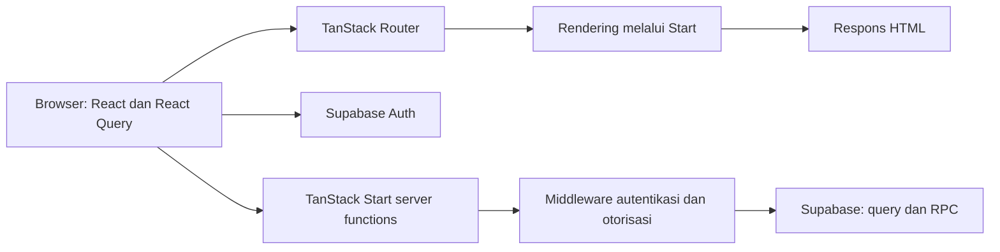

# Arsitektur

## Alur utama

Browser juga dapat memakai client Supabase untuk operasi yang tersedia melalui
kebijakan database. Diagram menunjukkan jalur utama, bukan inventaris seluruh
request.

## Batas tanggung jawab

- `src/routes/` mendefinisikan route dan komposisi halaman. Layout root berada di
  `__root.tsx`; `_authenticated.tsx` merupakan gerbang UI area yang memerlukan sesi.
- `src/components/` memuat komponen presentasi dan fitur; `src/lib/*.functions.ts`
  memuat banyak endpoint server berdasarkan domain.
- `src/start.ts` memasang middleware penempel autentikasi dan penanganan error.
  `src/server.ts` membungkus server entry untuk kegagalan SSR.
- `src/integrations/supabase/auth-middleware.ts` memverifikasi bearer token dan
  menyediakan client serta identitas pengguna pada context.
- Guard domain seperti `src/lib/finance-guard.ts` menambahkan pemeriksaan izin.
- `src/integrations/supabase/client.server.ts` menyediakan client service role
  yang melewati RLS. Setiap pemakaian membutuhkan otorisasi server yang memadai.
- Migrasi SQL menjadi riwayat perubahan skema dan kebijakan database. Inventaris
  kebijakan efektif harus diperiksa pada migrasi serta database target.

## Konfigurasi dan kode hasil generator

`vite.config.ts` memakai `@lovable.dev/vite-tanstack-config`, yang telah memasang
plugin Start, React, Tailwind, alias, dan integrasi Nitro. Jangan menggandakan
plugin tanpa memahami konfigurasi tersebut. Preset default Nitro adalah Cloudflare;
deployment ke penyedia lain harus diverifikasi melalui artefak build aktual.

`src/routeTree.gen.ts` dihasilkan generator. Jangan mengubahnya secara manual.
Perubahan kontrak data harus mempertimbangkan UI, validasi server, izin, migrasi,
serta pengujian dalam satu rencana. Catat keputusan di
[memori proyek](14-project-memory.md).
